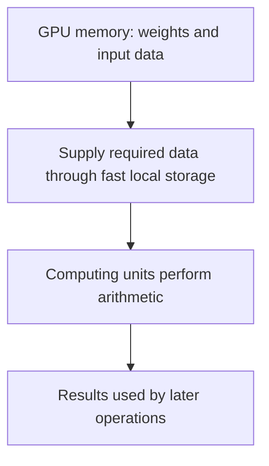

# Lesson 3: Compute and memory bottlenecks

[Previous: Prefill and decode](02-prefill-decode-kv-cache.md) · [Course overview](../README.md) · [Quick reference](../REFERENCE.md)

**Status:** Complete. [Lesson 4, batching and serving](04-batching-and-serving.md), is next. Every numerical example here is hypothetical; none is a GPU benchmark.

## 1. Separate storing, moving, and calculating

A weight is a number learned during training. During ordinary inference it stays fixed. Inputs and intermediate representations change with the tokens being processed.

In the toy rule `output = input × weight`, an input of 3 and a weight of 2 produce 6. The numbers are data; multiplication is computation.

Model weights are typically stored in GPU memory (VRAM). Computing units perform arithmetic. Data must be supplied to those units through the memory hierarchy, including faster local storage such as caches, shared memory, and registers.



The diagram is a simplified dependency, not a complete hardware layout.

| Resource | Question | Meaning |
| --- | --- | --- |
| Memory capacity | Does the data fit? | Amount of storage available |
| Memory bandwidth | Can data arrive quickly enough? | Amount of data transferred per second |
| Compute throughput | Can arithmetic finish quickly enough? | Arithmetic work performed per second |

A model fitting entirely in GPU memory answers only the capacity question. Slow transfers can leave computing units waiting. Conversely, fast transfers do not remove a large arithmetic workload.

Hardware changes can increase available throughput or bandwidth. Software and algorithmic changes can reduce required computation or data movement. Choose an improvement based on the limiting resource.

## 2. What does “shared weights” mean?

An attention projection transforms an input representation using a learned matrix. W_Q produces queries, W_K produces keys, and W_V produces values. Within one layer, four input positions use the same query-projection matrix:

```text
q1 = x1 W_Q
q2 = x2 W_Q
q3 = x3 W_Q
q4 = x4 W_Q
```

The layer applies one learned transformation across token positions. Training learns this layer's W_Q rather than a separate query-projection matrix for every position. The same principle applies to its W_K and W_V.

W_Q, W_K, and W_V are distinct matrices, and different layers generally have their own matrices. “Shared” here means shared across positions within the same layer, not identical weights everywhere in the model.

Stack the token representations as rows of X. The calculations can be expressed together as:

```text
Q = X W_Q
```

This is mathematical parameter sharing. The next section explains the separate hardware opportunity it creates.

## 3. Reusing a weight does not reuse the answer

Return to a single scalar weight, 2:

| Input | Calculation | Result |
| --- | --- | --- |
| 3 | 3 × 2 | 6 |
| 5 | 5 × 2 | 10 |
| 7 | 7 × 2 | 14 |
| 9 | 9 × 2 | 18 |

There are four different inputs and four multiplications. We cannot reuse the answer 6 for all inputs.

But if the weight remains nearby, we can fetch 2 once and use it in all four calculations, rather than fetch it separately for each calculation.

**Reuse saves repeated movement of the weight. It does not eliminate the arithmetic each input requires.**

This toy count excludes movement of inputs and outputs. In real matrix multiplication, the GPU processes pieces of the matrices. A loaded weight piece can serve calculations for multiple input rows. One mathematical matrix multiplication does not guarantee that the entire weight matrix is fetched exactly once.

## 4. Connect reuse to our six-token prompt

For `what is the capital of france`, assume six prompt inputs, as in Lesson 2.

At a given layer during prefill:

```text
Q_prompt = X_prompt W_Q        X_prompt has six rows
```

All six inputs are available for the projection. A loaded piece of W_Q can contribute to calculations for several rows.

After prefill selects Paris, processing Paris in a single-request decode step uses:

```text
q_Paris = x_Paris W_Q          x_Paris is one new row
```

The projection matrix is unchanged. The difference is how many new input rows are available together. Future generated tokens are not yet known, so their input rows cannot simply be included now.

This creates less opportunity for reuse **across new token rows within that decode operation**. It does not mean weights stop being shared or that every weight must always be fetched again from VRAM. Hardware caches and batching can provide other reuse opportunities; batching is Lesson 4.

Keep two kinds of reuse separate:

| Reused data | Benefit |
| --- | --- |
| Previous tokens' cached keys and values | Avoids recalculating those keys and values |
| Loaded pieces of model weights | Avoids some repeated weight transfers while applying the same transformation to multiple inputs |

## 5. More arithmetic per fetch

If a fetched scalar weight is used in six multiplications, it supports six operations per fetch instead of one. We can account for the transfer cost as 1/6 fetch per use; hardware does not perform a literal fractional fetch.

A matrix piece usually requires many operations per row. For it, say “six row-uses per fetch,” rather than exactly six arithmetic operations.

The broader idea is **arithmetic intensity**: arithmetic work per amount of data moved, often expressed as operations per byte. The relevant memory level and all relevant transfers matter in a full analysis. Our example isolates weight traffic to explain one contribution.

More uses of each fetched weight give more arithmetic per fetch.

## 6. How reuse can shift the bottleneck

For one hypothetical weight piece, assume:

- Fetching it takes 4 ms.
- Arithmetic using it takes 1 ms per row.
- It stays nearby for all rows.
- We temporarily exclude other transfers and model operations.

| Work | One row | Six rows |
| --- | ---: | ---: |
| Weight transfer | 4 ms | 4 ms |
| Arithmetic | 1 ms | 6 ms |

With one row, transfer takes longer. With six rows, arithmetic takes longer. The six inputs already required those calculations; reuse avoids repeatedly paying for the same weight transfer.

This explains why prefill often has more opportunity to become compute-bound, while small-batch decode is often bandwidth-bound. These are tendencies, not guarantees. Attention, context length, batch size, hardware, and implementation affect the real outcome.

The six-row operation does more total work than the one-row operation. A greater total duration would not imply worse performance per token.

## 7. Separate task times need not add

For unchanged arithmetic work and compute throughput, making transfer faster does not automatically shorten arithmetic time.

However, computation can sometimes use one piece of data while another piece is being fetched. Work can overlap.

For 4 ms of transfer and 6 ms of arithmetic:

- Fully sequential execution: 4 + 6 = 10 ms.
- Ideal complete overlap, with no other overhead: max(4, 6) = 6 ms.

```text
Idealized resource-work timeline:
Time          0                 4        6 ms
Transfer      [=================]
Arithmetic    [==========================]
```

This is an idealized resource-work model, not a claim that a calculation can use a weight before that weight arrives. Dependencies, pipeline startup and drain, and imperfect overlap can make real execution longer.

For the ideal model:

```text
Step time = max(arithmetic time, transfer time)
```

More generally, resource demands provide a lower bound:

```text
Compute demand = arithmetic operations / effective operations per second
Memory demand  = bytes transferred / effective bytes per second
Step time is at least max(compute demand, memory demand)
```

Use compatible precision, units, memory levels, and definitions. Actual performance must be measured; the model omits other costs.

## 8. Worked optimization comparison

Original requirements: 2 ms arithmetic and 8 ms transfer. Assume perfect overlap, unchanged work, and no other overheads. Each optimization below starts from the original case.

| Scenario | Arithmetic | Transfer | Ideal step time | Bottleneck |
| --- | ---: | ---: | ---: | --- |
| Original | 2 ms | 8 ms | max(2, 8) = 8 ms | Memory bandwidth |
| Double compute throughput | 1 ms | 8 ms | max(1, 8) = 8 ms | Memory bandwidth |
| Double memory bandwidth instead | 2 ms | 4 ms | max(2, 4) = 4 ms | Memory bandwidth |

Memory remains the bottleneck in all three cases, including the case where performance improves.

Improving a bottleneck does not necessarily remove it. Here, transfer becomes twice as fast but still takes longer than arithmetic.

## Recall before Lesson 4

1. Why doesn't fitting a model in VRAM guarantee fast inference?
2. What is shared in q1 = x1 W_Q and q2 = x2 W_Q?
3. Does weight reuse save calculations or repeated data movement in our example?
4. Does single-request decode have different projection weights from prefill?
5. With 6 ms arithmetic and 2 ms transfer, what is the ideal overlapped step time?
6. Can a useful optimization leave the same resource as the bottleneck?

<details>
<summary>Check your answers</summary>

1. Capacity does not establish bandwidth or arithmetic speed.
2. The same learned W_Q is applied to different input representations in that layer.
3. It saves repeated weight movement; each input still requires its calculations.
4. No. There are fewer new token rows available together, not different learned projection weights.
5. max(6, 2) = 6 ms; arithmetic remains the limiting resource.
6. Yes: reducing transfer from 8 ms to 4 ms with 2 ms arithmetic improves the ideal step time from 8 ms to 4 ms, while memory remains limiting.

</details>

**Takeaway:** Identify what limits the workload. Reuse can reduce data movement per calculation, and accelerating a non-limiting resource may produce little benefit.
